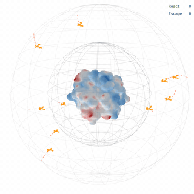

<div align="center">

<pre>
██████╗ ██╗   ██╗███████╗████████╗ █████╗ ██████╗  ██████╗
██╔══██╗╚██╗ ██╔╝██╔════╝╚══██╔══╝██╔══██╗██╔══██╗██╔════╝
██████╔╝ ╚████╔╝ ███████╗   ██║   ███████║██████╔╝██║     
██╔═══╝   ╚██╔╝  ╚════██║   ██║   ██╔══██║██╔══██╗██║     
██║        ██║   ███████║   ██║   ██║  ██║██║  ██║╚██████╗
╚═╝        ╚═╝   ╚══════╝   ╚═╝   ╚═╝  ╚═╝╚═╝  ╚═╝ ╚═════╝
</pre>

### Python Simulation Toolkit for Association Rate Constants

GPU-accelerated rigid body and flexible chain Brownian dynamics simulations for bimolecular association rate constants

<br>

[](https://github.com/anandojha/PySTARC/actions/workflows/ci.yml)
[](https://codecov.io/gh/anandojha/PySTARC)
[](https://www.codefactor.io/repository/github/anandojha/pystarc)

[](https://pypi.org/project/pystarc/)
[](https://pypi.org/project/pystarc/)
[](https://www.python.org/downloads/)
[](https://developer.nvidia.com/cuda-toolkit)

[](https://opensource.org/licenses/MIT)
[](https://github.com/psf/black)
[](https://github.com/anandojha/PySTARC/network/updates)
[](https://github.com/anandojha/PySTARC)

</div>

<div align="center">



</div>

---

## Overview

PySTARC computes the bimolecular association rate constants by implementing rigid-body Brownian dynamics within the Northrup-Allison-McCammon formalism. Trajectories of rigid solutes run in parallel on an NVIDIA GPU with CUDA 12 or newer. The flexible chain model runs on CPUs.

## Installation

**GPU (Linux / HPC GPU node):**

```bash
git clone https://github.com/anandojha/PySTARC.git
cd PySTARC
bash install.sh
```

`install.sh` creates a fresh `PySTARC` conda environment (replacing any existing `PySTARC` environment) and stops before changing anything if no NVIDIA GPU with CUDA 12+ is visible. On a GPU-less HPC login node, run the CPU commands below plus `pip install "cupy-cuda12x[ctk]>=14"`.

**CPU (flexible chain BD):**

```bash
git clone https://github.com/anandojha/PySTARC.git
cd PySTARC
conda create -n PySTARC python=3.11 -y
conda activate PySTARC
conda install -c conda-forge "numpy>=2.0,<2.6" ambertools=24.8 apbs rdkit openbabel -y
pip install -e .
```

## Testing

```bash
python -m pytest tests/
python -m pytest tests/ -v
```

## Quick start

```bash
conda activate PySTARC
cd examples/two_charged_spheres
bash run.sh
```

For a short smoke check on one GPU, lower `<n_trajectories>` in `config.xml` from `20000000` to `10000` (`k_on ≈ 1.75 × 10¹⁰ M⁻¹ s⁻¹`, exact Debye-Smoluchowski limit).

## Tutorials

[`TUTORIAL.md`](TUTORIAL.md) works through the trypsin-benzamidine example step by step and explains every tag of `config.xml`. [`scripts/README.md`](scripts/README.md) documents `prepare_pdb.py`, `find_reaction_criteria.py`, and `verify_criteria.py` for preparing raw PDB structures and reaction criteria. [`pystarc/CHAINS.md`](pystarc/CHAINS.md) documents the COFFDROP flexible chain API.

See [`examples/`](examples/) for the tutorials. Each complex has its own README listing the inputs, run commands, and outputs. Start with `two_charged_spheres` to validate the installation against the analytical rate. The `barnase_barstar` tutorial demonstrates the flexible chain workflow.

```
examples/
├── two_charged_spheres/              Analytical validation for the exact Smoluchowski solution
├── trypsin_benzamidine/              Protein-ligand complex
├── beta_cyclodextrin_guests/         Host-guest complexes
├── thrombin_thrombomodulin/          Protein-protein complex
├── p38_mapk_sb203580/                Protein-ligand complex
├── carbonic_anhydrase_inhibitors/    Protein-ligand complexes
├── hsp90_inhibitors/                 Protein-ligand complexes
├── ttk_inhibitors/                   Protein-ligand complexes
└── barnase_barstar/                  Protein-protein complex with a flexible chain on CPUs
```

## Requirements

```
Python 3.10+
AmberTools 24.8
APBS
OpenBabel
RDKit
NumPy
SciPy
Click
Numba
Matplotlib
CuPy
```

## License

MIT

## Citation

Please cite:

> Anupam Anand Ojha, Gary Huber, Shiksha Dutta, Sonya M. Hanson. PySTARC: GPU-accelerated Brownian dynamics for bimolecular association rate constants (2026). https://doi.org/10.64898/2026.09.28.754770
